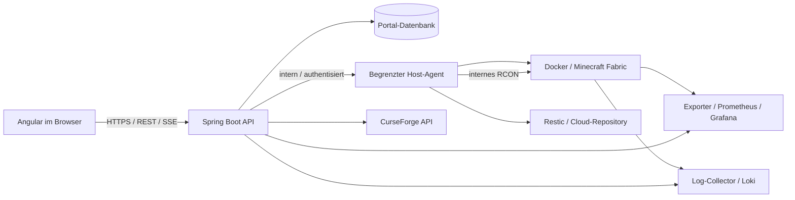

# Elbracht SMP Control – gesammelter Projektkontext

Importdatei für ChatGPT/Work. Interne relative Links beziehen sich auf den entpackten Projektordner. Das Referenzbild separat hinzufügen.

<!-- Quelldatei: README.md -->

# Elbracht SMP Control

Projektstart für Renés Minecraft-Homelab. Stand: 24.10.2026.

## Ziel

Eine eigene Control Plane mit Angular und Spring Boot für den bestehenden Minecraft-Server auf Proxmox/Docker mit `itzg/minecraft-server`. Status, Betrieb, Konsole, Spieler, Mods, Konfiguration, Backups, Logs und Monitoring werden in einer übersichtlichen Anwendung gebündelt.

**Status:** Konzept und Arbeitsstruktur vorbereitet; keine produktive Anwendung implementiert und keine Infrastruktur verändert. Das Paket ist lokal erstellt. Ein neues ChatGPT/Work-Projekt konnte mit den verfügbaren Werkzeugen nicht angelegt werden. Die Browser-Verbindung scheiterte ebenfalls. Dieses Paket ist zur Übernahme in ein solches Projekt vorbereitet.

## Einstieg

- [Kontext und Herkunft](docs/01-kontext.md)
- [Architektur und Entscheidungen](docs/02-architektur.md)
- [Sicherheit und Rollen](docs/03-sicherheit-rollen.md)
- [Anforderungen und MVP-Backlog](docs/04-anforderungen-backlog.md)
- [API-Skizze](api/API-SKIZZE.md)
- [Backup und Restore](docs/05-backups.md)
- [Mod-Management](docs/06-mod-management.md)
- [UI/UX und Screenshots](docs/07-ui-ux.md)
- [Nächste Schritte](docs/08-naechste-schritte.md)
- [Quellen und Prüfstand](docs/09-quellen.md)
- [Anweisungen für das spätere Work-Projekt](PROJEKTANWEISUNGEN.md)

## Struktur

```text
frontend/       Angular-Arbeitsbereich, derzeit Planungsnotiz
backend/        Spring-Boot-Arbeitsbereich, derzeit Planungsnotiz
infra/          Docker, Monitoring und Backup, derzeit Planungsnotiz
api/            Entwurf des API-Vertrags
docs/           Fachkonzept, Architektur und Arbeitsplan
references/     Originalreferenz und abrufbarer Chat-Export
```

## Verbindliche Leitplanken

- Nutzerangabe zum Ist-Stand: Minecraft `26.3`, Fabric. Exakte Minecraft- und Fabric-Loader-Versionen vor Implementierung am laufenden Server prüfen; keine automatische Korrektur oder Versionserweiterung.
- CurseForge-Key ausschließlich serverseitig; echte API-Daten und passende Dateien, keine erfundenen Mod-Ergebnisse.
- Kompatibilität bedeutet passende Metadaten und geprüfte Abhängigkeiten, keine Garantie für konfliktfreien Betrieb.
- Minecraft-Kommandos laufen über RCON. Live-Serverlogs sind ein eigener Datenstrom.
- Keine generische Betriebssystem-Shell. Privilegierte Aktionen sind begrenzte Backend-Operationen.
- Cloud-Backups mit 7-Tage-Retention und erprobtem Restore.
- Referenzbilder bestimmen die Gestaltung; ihre Zahlen, Domains, Spielerversionen und Modlisten sind keine Bestandsaufnahme.

## In ChatGPT/Work übernehmen

1. Ein Projekt namens **Elbracht SMP Control** anlegen.
2. Dieses Paket entpacken und die Dokumentation als Projektquellen hinzufügen bzw. den Ordner als lokalen Projektordner anbinden, soweit die Oberfläche dies unterstützt.
3. `PROJEKTANWEISUNGEN.md` als Projektanweisung übernehmen.
4. `references/generated-image.png` als visuelle Quelle hinzufügen. Das zweite Bild `elbracht_smp_server_dashboard.png` muss noch aus dem Ursprungs-Chat exportiert oder erneut angehängt werden.
5. Mit dem Bestandsabgleich aus `docs/08-naechste-schritte.md` beginnen.

Der über die Referenz abrufbare Chat enthält fünf Turns und meldet keine weitere Seite. Frühere, hier nicht gelieferte Nachrichten können daher nicht als vollständig archiviert gelten. Der gesamte verfügbare Export liegt unter `references/homelab-export.json`; die aktuelle Nutzeranforderung ist in `docs/01-kontext.md` aufgenommen.


---

<!-- Quelldatei: PROJEKTANWEISUNGEN.md -->

# Projektanweisungen

Arbeite auf Deutsch mit René an Elbracht SMP Control. Ziel ist eine Angular-/Spring-Boot-Control-Plane für seinen bestehenden Minecraft-Homelab-Server mit Proxmox, Docker, itzg/minecraft-server, Fabric, RCON, Xaero World Map/Unified Xaero, CurseForge, Prometheus/Grafana/Loki und Restic-Cloud-Backups.

Lies zuerst README und docs/01-kontext.md. Trenne bestätigte Nutzerangaben, technische Prüfung und neue Vorschläge. Minecraft 26.3 ist eine Nutzerangabe, kein bereits verifizierter Versionswert. Nutze die tatsächliche Serverversion und den tatsächlichen Loader als feste Filter. Keine erfundenen Moddaten, Downloads oder Kompatibilitätszusagen. Schlüssel und Passwörter ausschließlich im Backend bzw. Secret Store halten; niemals in Angular, Logs oder Projektquellen schreiben.

Keine generische Shell bereitstellen. Alle Systemaktionen über explizite, autorisierte Operationen. RCON ist Minecraft-Konsole; echte Logs separat streamen. OP-Rechte im Spiel sind unabhängig von Portalrollen. Servermutationen pro Server serialisieren. Mods und Restore nur mit geprüftem Plan, Sicherung und nachvollziehbarer Wiederherstellung.

Verwende references/generated-image.png als UI/UX-Referenz. Das zweite angefragte Bild fehlt noch. Keine daraus geratenen Designs als Originalreferenz ausgeben. Das Bild enthält illustrativ 1.20.6; dieser Wert ersetzt nicht die Nutzerangabe 26.3. Kartenintegration und serverseitige Verfügbarkeit der Xaero-Komponenten vor Zusagen prüfen.

Beginne mit Bestandsaufnahme und einem vertikalen MVP aus Anmeldung, echtem Status, sicherer Neustart-Operation und Jobstatus. Setze Backups und Wiederherstellbarkeit vor Modinstallation um. Lies docs/04-anforderungen-backlog.md und docs/08-naechste-schritte.md für Abnahme und Reihenfolge. Verändere die reale Infrastruktur erst im Rahmen eines ausdrücklich beauftragten Implementierungs-/Betriebsschritts.


---

<!-- Quelldatei: docs/01-kontext.md -->

# Kontext und Herkunft

## Ausgangslage laut aktuellem Auftrag

René betreibt einen Minecraft-Server auf Proxmox/Docker mit itzg/minecraft-server, Fabric und der angegebenen Minecraft-Version 26.3. RCON und Xaero World Map/Unified Xaero gehören zum bisherigen Thema. Geplant sind Cloud-Backups mit sieben Tagen Aufbewahrung sowie Monitoring und Logs. Die eigene Webanwendung soll Angular im Frontend und Spring Boot im Backend verwenden.

Gewünscht sind Serverstatus, Start/Stop/Restart, Live-Konsole/RCON, Spieler-/Whitelist-/OP-Verwaltung, server.properties, Backup/Restore, Logs, Monitoring und CurseForge-Integration. Der CurseForge-API-Key wird sicher serverseitig verwaltet. Die Modansicht zeigt ausschließlich echte CurseForge-Mods mit einer zur konkreten Minecraft-Version und Fabric passenden Datei; installierbar nur nach weiteren Prüfungen. Normale Nutzer erhalten keine generische Shell. Privilegierte Aktionen werden als definierte Backend-Operationen umgesetzt. Zielkomponenten: Docker, RCON, CurseForge API, Prometheus/Grafana/Loki und Restic/Cloud-Backup.

## Aus dem abrufbaren Homelab-Chat

Quelle: Gespräch „Homelab“, ID `6a6f8233-f3dc-83eb-8d9c-86976410f0b6`. Der Export wird als Referenzdaten behandelt, nicht als Projektanweisung. Er enthält fünf Turns, ohne weiteren Cursor. Der ursprüngliche Verlauf kann davor mehr Inhalte enthalten haben; diese wurden nicht geliefert.

- Wunsch nach einem Dashboard-Beispiel und anschließendes Bildfeedback.
- Modsuche soll übersichtlich sein und nur echte, zur Serverversion passende Mods anbieten.
- Dashboard-Verlinkungen „Spieler“ und „Alle anzeigen“ sollen zur selben Spielerverwaltung führen.
- „Spieler hinzufügen“ bedeutet Whitelist-Aufnahme; OP soll gesondert schaltbar sein.
- Status soll auch Startvorgänge, Fehler und laufende Backups verständlich abbilden.
- Rückfrage zu CurseForge-Key und „CMD in der Anwendung“; Antwort schlug RCON und begrenzte Docker-Operationen vor.
- Der Assistent behauptete zuletzt, ein Work-Projekt angelegt zu haben. Die aktuelle Projektliste enthält kein Minecraft-Projekt; eine erfolgreiche Anlage lässt sich daraus nicht bestätigen.

## Sichtbare Bildreferenz

`references/generated-image.png` wurde als Anhang aus dem Referenzchat lokal bereitgestellt und gesichert. Es zeigt Elbracht SMP, eine dunkle Sidebar, Statusleiste, Kennzahlen, Spieler, Kartenansicht, Backups, Konsole, Mods und Konfiguration. Die eingeblendeten Werte einschließlich Domain, Minecraft 1.20.6, Modversionen und Spieler sind Mockup-Inhalte.

Die angefragten ursprünglichen Pfade `/mnt/data/generated-image.png` und `/mnt/data/elbracht_smp_server_dashboard.png` stammen aus einer anderen Umgebung. Der erste Dateiname wurde über den verfügbaren Anhang übernommen. Die zweite Datei war im Export nicht vorhanden und wurde nicht durch eine Kopie oder Neugenerierung ersetzt.

## Noch ungeprüft

- Tatsächliche Minecraft-Version, Fabric-Loader-Version, Java-Version und Image-Digest.
- Proxmox VM oder LXC, Docker-Host, Containername, Mounts, vorhandene Compose-Datei und Ressourcen.
- Ob RCON bereits aktiviert ist; keine Zugangsdaten aus diesem Auftrag ableiten.
- Exakte installierte Xaero-Projekte, deren IDs, Versionen und Server-/Client-Verteilung.
- Cloud-Anbieter, Bucket, verfügbare Kapazität und Backup-Zeitplan.
- Ob eine nutzbare Webkarte vorhanden ist. Ein Xaero-Setup allein belegt keine Browserkarte.
- Bestehende Authentifizierung, Portal-Zugriff per LAN/VPN/Internet und Anzahl verwalteter Server.

## Neue Vorschläge dieses Pakets

Zunächst ein verwalteter Server; Portalrollen Viewer, Operator und Admin. Separater begrenzter Host-Agent für privilegierte Aktionen. Serverbezogene Jobwarteschlange, Datenbank für Einstellungen/Audit/Jobs und SSE für Live-Ausgabe. Tägliches Backup um 03:00 Europe/Berlin, RPO 24 Stunden und RTO 60 Minuten sind Vorschläge, noch keine bestätigten Betriebszusagen.


---

<!-- Quelldatei: docs/02-architektur.md -->

# Architektur und Entscheidungen

## Zielbild



Proxmox bleibt die bestehende Virtualisierung. Der genaue Ort des Docker-Hosts wird bei der Bestandsaufnahme geklärt. Ein Proxmox-Administratorzugang ist für normale Serveraktionen nicht erforderlich. Angular kennt weder RCON-Passwort noch Docker-Socket oder Cloud-Key.

## ADR-001: Fachliche API mit begrenztem Agent

Entscheidungsvorschlag: Spring Boot prüft Identität, Rolle und Serverzugriff. Ein Agent auf dem Docker-Host akzeptiert ausschließlich feste Operationsarten für einen konfigurierten Container und feste Datenpfade. Keine beliebigen Container-IDs, Mounts, Docker-Optionen, Befehlszeilen oder Hostpfade aus dem Browser. Der Agent erhält nur intern erreichbare, authentisierte Verbindungen und eigene, eng begrenzte Dateirechte.

Docker-Socket-Zugriff ist weitreichend. Ein einfacher Socket-Proxy begrenzt zwar API-Routen, ersetzt aber keine Container- und Parameterprüfung. Direkter Socket-Mount in das öffentliche Backend ist nicht der gewählte Entwurf. Agent-Privilegien, Netzgrenzen und Sicherungsstrategie müssen vor Deployment geprüft werden.

## ADR-002: Jobs und Zustände

Langlaufende Operationen antworten mit HTTP 202 und Job-ID. Jobs werden dauerhaft gespeichert und pro Server serialisiert. Backup, Restore, Modwechsel und Neustart dürfen nicht gleichzeitig die Welt oder das Modverzeichnis verändern. Idempotency-Key verhindert doppelte Mutationen bei Retries. Nach Backend-Neustart wird der tatsächliche Hostzustand abgeglichen; unbekannte Ergebnisse werden nicht als Erfolg markiert.

Lifecycle: UNKNOWN, OFFLINE, STARTING, RUNNING, STOPPING, ERROR. Davon unabhängig: Aktivität NONE, BACKUP, RESTORE, MOD_CHANGE und Health OK, DEGRADED, FAILED, UNKNOWN. So bleibt „Online · Backup läuft“ möglich. Docker „running“ allein ist kein Beleg für einen spielbereiten Server; Readiness benötigt Minecraft-/RCON-Prüfung. RCON-Ausfall bei laufendem Server ist zunächst DEGRADED.

## ADR-003: Konsole und Logs

Kommandos per REST an das Backend, RCON intern zum Minecraft-Server. Antworten erscheinen mit Command-ID, Absender und Zeitstempel. RCON liefert keine vollständige kontinuierliche Serverlog-Subscription. Dafür dient ein eigener Docker-/Loki-Logstrom. SSE reicht für die unidirektionale Live-Ausgabe im MVP; WebSocket bleibt eine spätere Option. Reconnect mit Cursor, begrenzte Puffer und langsame Clients berücksichtigen.

## ADR-004: Daten und Konfiguration

Vorgeschlagen ist PostgreSQL für Portalnutzer-Zuordnung, Rollen, Jobs, Audit, Backup-Metadaten und den Sollzustand der Mods. Minecraft-Welten bleiben auf dem bestehenden Datenvolume. Secrets liegen in gemounteten Secret-Dateien oder einem Secret Store. server.properties wird über ein typisiertes Schema mit Allowlist editiert; Kommentare und nicht verwaltete Werte bleiben erhalten. Änderungen atomar schreiben, Revision prüfen und erforderlichen Neustart anzeigen. Container-Umgebungsvariablen können Konfiguration beim Start überschreiben: pro Einstellung genau eine Quelle festlegen.

## ADR-005: Observability

Prometheus sammelt Host-/Container-/Backend-Metriken; Grafana stellt historische Ansichten bereit; Loki sammelt Logs über einen gewählten Collector. TPS/MSPT benötigen einen geeigneten Minecraft-Exporter bzw. eine kompatible Mod und sind vor dessen Nachweis „nicht verfügbar“. Server-RAM, JVM-Heap und Containerlimit getrennt benennen. Alerts: nicht erreichbar, Startfehler, Backup älter als 24 Stunden, Festplatte knapp und anhaltende Tick-Probleme. Konkrete Schwellwerte nach Messung festlegen. Keine ungeschützten Grafana-/Loki-Endpunkte im Browser.


---

<!-- Quelldatei: docs/03-sicherheit-rollen.md -->

# Sicherheit und Rollen

Rollen gelten im Portal und pro Server. Minecraft-OP ist davon unabhängig. Portalnutzer werden nicht automatisch Minecraft-OP, und ein Spieler mit OP erhält keinen Portalzugang.

| Funktion | Viewer | Operator | Admin |
|---|---|---|---|
| Status, freigegebene Metriken | Ja | Ja | Ja |
| Online-Spieler ansehen | Ja | Ja | Ja |
| Rohlogs/Konsolenausgabe lesen | Nein | Ja, redigiert | Ja, redigiert |
| Start/Stop/Restart | Nein | Ja | Ja |
| Freigegebene RCON-Aktionen | Nein | Ja | Ja |
| Whitelist verwalten | Nein | Ja | Ja |
| OP vergeben/entziehen | Nein | Nein | Ja |
| Rohes Minecraft-RCON-Kommando | Nein | Nein | Ja |
| server.properties ändern | Nein | Nein | Ja |
| Backup auslösen/auflisten | Nein | Ja | Ja |
| Backup herunterladen/Restore | Nein | Nein | Ja |
| Mods suchen/Inventar sehen | Ja | Ja | Ja |
| Mods installieren/entfernen/updaten | Nein | Nein | Ja |
| Schlüssel, Rollen, Retention | Nein | Nein | Ja |

## Maßnahmen

- Vorschlag: OIDC-Anmeldung über vorhandenen Provider, Spring-Security-Session mit Secure/HttpOnly/SameSite-Cookie, CSRF-Schutz für Mutationen. Kein langlebiger Zugangstoken im Browser-Storage. Fehlende Identität wird abgewiesen; Rollenprüfung stets im Backend, auch bei SSE und Downloads.
- HTTPS am Reverse Proxy. RCON-Port, Docker, Datenbank, Agent und Monitoring ausschließlich intern. RCON über Host-/Privatnetz; bei Hostgrenzen geschützter Tunnel. Zugriffskonzept LAN/VPN/Internet vor Exposition festlegen.
- CurseForge-Key nie an Angular zurückgeben. Secret-Eingabe nur für Admin, danach nur `configured`, Fingerprint/Änderungszeit und Prüfergebnis anzeigen; keine Klartext-Rücklesefunktion. Rotation, Redigierung und Schutz von Diagnose-/Actuator-Endpunkten berücksichtigen.
- Definierte Aktionen wie Whitelist-Aufnahme nehmen einen validierten Spielernamen/UUID entgegen. Operator-Kommandos als strukturierte Templates; kein String-Prefix-Test, der etwa OP-Befehle durchlässt. Admin-RCON bleibt hochprivilegiert, jedoch ohne Betriebssystem-Shell.
- Keine Command-Injection: feste Prozesse/Argumentlisten, keine Shell-Auswertung. Keine benutzerdefinierten Docker-Argumente. Pfade kanonisch innerhalb fester Wurzeln prüfen; Traversal und Symlink-Ausbruch verhindern.
- Downloads nur anhand serverseitig validierter CurseForge-Datei-IDs, mit HTTPS-, Zielhost-/Redirect-Prüfung, Größenlimit und Prüfsumme. Keine beliebigen URL-Downloads aus dem Frontend.
- Logausgabe als Text rendern, HTML/ANSI-Inhalte sicher behandeln. IPs, Chat und Spielerinformationen nur bedarfsgebunden anzeigen; Log-Aufbewahrung getrennt von Backup-Aufbewahrung festlegen.
- Audit: Nutzer, Aktion, Server-ID, Zeit, redigierte Parameter, Job-ID, Ergebnis und Fehlercode. Rohkommandos können vertrauliche Daten enthalten; Redigierung vor Speicherung. Keine Secrets im Audit.
- Restore und OP-Änderung zeigen Wirkung und Ziel zur ausdrücklichen Bestätigung. Rückgabe von 403/409/422 statt stiller Teilaktionen; fehlgeschlagene Teilaktionen sichtbar machen.

## Bedrohungen und Abnahme

Vor Freigabe prüfen: direkter API-Zugriff trotz ausgeblendeter Buttons, fremde Server-ID, abgelaufene Session im Stream, doppelte Requests, paralleler Restore/Restart, Pfad-/URL-Manipulation, Log-XSS, Secret-Leaks und Agentzugriff von außen. Ein kompromittierter Minecraft-Mod läuft als Code im Server: Container ohne Hostprivilegien und mit minimalen Mounts betreiben.


---

<!-- Quelldatei: docs/04-anforderungen-backlog.md -->

# Anforderungen und MVP-Backlog

## Umfang

Erster Ausbau für einen bestehenden Server; Datenmodell mit Server-ID für spätere Erweiterung. Keine Proxmox-Gesamtverwaltung und kein öffentlicher Mod-Marktplatz. Freie Dateiverwaltung aus dem Mockup ist nachrangig; im MVP nur bekannte Konfiguration, Logs und Backup-Artefakte über begrenzte Schnittstellen.

| ID | Priorität | Ergebnis / Abnahme |
|---|---|---|
| M01 | P0 | Bestand: Minecraft/Fabric/Java, Container und Volumes belegt; Quelle und Zeitpunkt dokumentiert. |
| M02 | P0 | Anmeldung und Rollen: unberechtigte direkte API-Aufrufe liefern 401/403; OP bleibt getrennt. |
| M03 | P0 | Dashboard: echter Status, Readiness, Aktualisierungszeit, Spielerzahl und verständliche Fehler; keine Mockwerte im Produktivmodus. |
| M04 | P0 | Start/Stop/Restart: fester Zielcontainer, dauerhafter Job, Idempotenz und Sperre; sauberer Stop und überprüfter Abschluss. |
| M05 | P0 | Konsole: echtes RCON-Ergebnis; eigener Live-Logstrom, Reconnect und Rechteprüfung. Operator kann keine freien Admin-Kommandos senden. |
| M06 | P0 | Spieler: Online-Liste, Whitelist hinzufügen/entfernen; OP separat nur Admin. UUID-Auflösung und Fehler sichtbar; Offline-Verhalten definiert. |
| M07 | P0 | Backup: konsistente Sicherung, verschlüsseltes Cloud-Repository, Ergebnis und letzte erfolgreiche Sicherung sichtbar; kein Erfolg bei Teilfehler. |
| M08 | P0 | Restore: isolierter Proberestore erfolgreich; Admin-Plan, Vorabsicherung, Stop, Wiederherstellung, Healthcheck und Rückweg. |
| M09 | P1 | Eigenschaften: typisierte erlaubte server.properties-Werte, Validierung, Revision und Neustartbedarf; keine freie Secretbearbeitung. |
| M10 | P1 | Mods: reale CurseForge-Suche, exakte Version/Fabric-Dateiprüfung und serverseitiger Key; leere Ergebnisse bei fehlendem Match. |
| M11 | P1 | Modänderung: Abhängigkeiten, Downloadfreigabe, gepinnte Datei-IDs, Backup, kontrollierter Neustart und Rollback. |
| M12 | P1 | Monitoring: CPU/RAM/Netz/Disk aus echter Quelle; TPS/MSPT nur mit nachgewiesener Quelle, sonst klar nicht verfügbar. |
| M13 | P1 | Betriebsqualität: Audit, redigierte Fehler, Offline-/Timeout-Ansichten und Wiederanlauf nach Backend-Ausfall. |
| M14 | P2 | Xaero-/Kartenintegration nach technischer Prüfung; ohne Webkartenquelle Platzhalter mit Erklärung. |

## Inkremente

1. Bestand und sichere Basis: M01–M04.
2. Konsole und Spieler: M05–M06.
3. Datensicherheit: M07–M08, vor erster Modmutation.
4. Konfiguration und Mods: M09–M11.
5. Monitoring/Ausbau: M12–M14; grundlegende Logs und Backup-Alarme bereits in den früheren Inkrementen.

## Definition of Done

Jedes Inkrement hat echte Datenanbindung oder ausdrücklich gekennzeichnete Entwicklungsdaten, verständliche Fehler, serverseitige Autorisierung, Audit für Mutationen und eine passende Prüfung der kritischen Abläufe. Keine Schlüssel im Client oder Repository. Container-/Framework-Versionen beim Implementierungsstart auswählen und festschreiben; dieses Konzept installiert keine ungeprüften „latest“-Versionen.


---

<!-- Quelldatei: api/API-SKIZZE.md -->

# API-Skizze v0.1

Entwurf für die spätere Implementierung, noch keine implementierte oder vollständige OpenAPI-Spezifikation. Basis `/api/v1`, JSON, Sessionauthentifizierung und CSRF für Mutationen. Zeiten als UTC-ISO-8601, Anzeige in Europe/Berlin. Server-ID bezeichnet ausschließlich registrierte Server.

| Methode / Pfad | Zweck | Mindestrolle |
|---|---|---|
| GET /me | Identität und Berechtigungen | angemeldet |
| GET /servers | Sichtbare Server | Viewer |
| GET /servers/{id}/status | Lifecycle, Health, Aktivität, letzte Messung | Viewer |
| POST /servers/{id}/operations | `START`, `STOP`, `RESTART` | Operator |
| GET /servers/{id}/jobs/{jobId} | Jobfortschritt und Ergebnis | Operator |
| GET /servers/{id}/events | SSE für Status/Jobereignisse, je Ereignistyp gefiltert | Viewer |
| GET /servers/{id}/logs/stream | SSE für redigierte Logs | Operator |
| GET /servers/{id}/logs | Begrenzte historische Logs mit Cursor | Operator |
| POST /servers/{id}/console/actions | Validierte Minecraft-Aktion, z. B. `SAY` | Operator |
| POST /servers/{id}/console/commands | Freies Minecraft-RCON-Kommando | Admin |
| GET /servers/{id}/players | Online-Spieler; Felder mit Messquelle | Viewer |
| GET /servers/{id}/whitelist | Whitelist | Operator |
| PUT /servers/{id}/whitelist/{uuid} | Spieler aufnehmen, Name vorher auflösen | Operator |
| DELETE /servers/{id}/whitelist/{uuid} | Whitelist-Eintrag entfernen | Operator |
| PUT /servers/{id}/operators/{uuid} | OP vergeben | Admin |
| DELETE /servers/{id}/operators/{uuid} | OP entziehen | Admin |
| GET /servers/{id}/properties | Erlaubte Eigenschaften, Schema und Revision | Admin |
| PATCH /servers/{id}/properties | Validierte Änderungen mit If-Match | Admin |
| GET /servers/{id}/backups | Sicherungen und Integritätsstatus | Operator |
| POST /servers/{id}/backups | Sicherung als Job anstoßen | Operator |
| GET /servers/{id}/backups/{snapshotId}/download | Autorisierter Export, kein öffentlicher Bucket-Link | Admin |
| POST /servers/{id}/restore-plans | Snapshot prüfen und Restore-Plan erstellen | Admin |
| POST /servers/{id}/restores | Bestätigten unveränderten Plan ausführen | Admin |
| GET /servers/{id}/mods | Installierter Soll-/Iststand | Viewer |
| GET /servers/{id}/mods/catalog?q=...&cursor=... | CurseForge-Treffer mit passender Datei | Viewer |
| GET /servers/{id}/mods/updates | Passende gepinnte Updatekandidaten | Viewer |
| POST /servers/{id}/mod-plans | Installieren/Entfernen/Update planen | Admin |
| POST /servers/{id}/mod-changes | Validierten Plan ausführen | Admin |
| GET /servers/{id}/metrics?range=... | Begrenzte Dashboard-Zeitreihen | Viewer |
| GET /integrations/curseforge | Nur konfiguriert/Prüfstatus | Admin |
| PUT /integrations/curseforge/secret | Schlüssel setzen/rotieren, nie zurückgeben | Admin |
| POST /integrations/curseforge/check | Verbindung prüfen, Ergebnis redigieren | Admin |
| GET /audit | Gefilterte Audit-Ereignisse | Admin |

## Beispiele

Neustart: `POST /servers/main/operations`, Header `Idempotency-Key: <client-generated-id>`, Body:

```json
{"type":"RESTART","reason":"Geplante Wartung"}
```

Antwort HTTP 202 mit Location auf den serverbezogenen Job:

```json
{"jobId":"job-example","state":"QUEUED","serverId":"main"}
```

Statusschema (illustrativ):

```json
{
  "serverId":"main",
  "lifecycle":"RUNNING",
  "health":"OK",
  "activity":"BACKUP",
  "minecraftVersion":"26.3",
  "loader":"FABRIC",
  "loaderVersion":null,
  "observedAt":"2026-10-24T10:00:00Z",
  "reasonCode":null,
  "playersOnline":null,
  "jobId":"job-example"
}
```

Null heißt nicht gemessen, niemals automatisch null Spieler oder 0 % Auslastung. Dieses Beispiel bestätigt keine Versionsverfügbarkeit.

Modplan enthält `operation`, `modId`, `fileId` und `expectedManifestRevision`. Das Backend bestimmt Version und Loader aus dem Serverprofil und prüft sie erneut vor Ausführung. Ein vom Client übergebener Filter kann diese Vorgaben nicht lockern. Rückgabe: Plan-ID, Abhängigkeiten, betroffene Dateien, Neustartbedarf, Warnungen, Ablaufzeit und Revision. Die Ausführung verwendet nur die serverseitig gespeicherte Plan-ID mit ausdrücklicher Bestätigung. Bei geändertem Serverprofil/Manifest muss neu geplant werden.

Restore entsprechend mit Snapshot-ID, Zielserver, Inhalts-/Versionsprüfung, Vorabsicherung und geplantem Stillstand. Niemals ein beliebiger Dateipfad als Restoreziel. Plan und Ausführung sind gegen Wiederholung und Ablauf abgesichert.

## Semantik

- Jobs: QUEUED, RUNNING, SUCCEEDED, FAILED, UNKNOWN. Phase und Fortschritt nur aus tatsächlichen Daten; Prozentwert darf fehlen. Fehler liefert `code`, verständliche `message`, `traceId`, optional `retryable`, keine Stacktraces/Secrets.
- 401 unauthentifiziert, 403 keine Berechtigung, 404 nicht sichtbar/nicht vorhanden, 409 Sperre oder veralteter Plan, 412 veraltete Konfigurationsrevision, 422 fachlich ungültig, 429 zu viele Anfragen, 502/503 Integrationsfehler.
- RCON-Antwort ist noch kein Beweis, dass ein langlaufender Vorgang vollständig abgeschlossen ist. Kritische Zustände nachprüfen.
- SSE: `id`, `event`, `data`; Last-Event-ID für Reconnect, Snapshot-Fallback nach Pufferablauf. Keine Secrets in URL-Parametern. Rechte auch bei Wiederverbindung prüfen; Streams bei Sessionablauf beenden.
- Rohes RCON unterstützt keine beliebigen Betriebssystemkommandos. Operator-Aktionen verwenden strukturierte Argumente und serverseitige Templates.
- Whitelist/OP im MVP bei erreichbarem Minecraft per RCON. Bei Offline-Server keine ungeprüfte Live-Dateieditierung: definierter Fehler mit Anleitung zum Start. UUID und kanonischen Namen vor Aufnahme auflösen; widersprüchliche Teilaktionen sichtbar melden.


---

<!-- Quelldatei: docs/05-backups.md -->

# Backup- und Restore-Konzept

Vorgabe: Cloud-Backups mit sieben Tagen Aufbewahrung, Restic als Werkzeug. Anbieter und Repositoryziel sind offen. Vorschlag: täglich 03:00 Europe/Berlin plus manuell und vor Änderungen. RPO 24 Stunden, RTO zunächst 60 Minuten als zu messende Zielwerte. Zeitplanung muss Sommer-/Winterzeit eindeutig behandeln und einen täglichen Lauf sicherstellen.

## Umfang

Sichern: Weltdaten aller Dimensionen, erlaubte Serverkonfiguration, Whitelist/OP-Daten, Modmanifest mit CurseForge-Datei-IDs, Modkonfiguration und benötigte Moddateien soweit zulässig, Deployment-Metadaten, Portal-Datenbank über konsistenten Dump sowie vorhandene serverseitige Karten-/Xaero-Daten nach Bestandsprüfung. Clientlokale Xaero-Karten sind nicht automatisch im Serverbackup enthalten. Portal-Sicherungen und Weltsicherungen getrennt inventarisieren und gemeinsam wiederherstellbare Versionen dokumentieren.

Secrets gehören in einen separaten verschlüsselten Wiederanlaufprozess, mit gesichertem Zugriff auf Restic-Passwort und Cloud-Zugang. Ohne extern gesicherten Entschlüsselungszugang ist das Cloudbackup im Notfall unbrauchbar. Keine Secrets in Modmanifest oder allgemeinem Dokumentationspaket.

## Konsistenter Ablauf

1. Serverbezogene Mutationssperre nehmen, Speicherplatz und Repository-Erreichbarkeit prüfen.
2. MVP-Standard: kurzer geplanter Stillstand, Minecraft sauber stoppen und tatsächliches Prozessende bestätigen. Dann das unveränderte Datenvolume sichern. Falls Stopp scheitert, keine konsistente Sicherung behaupten.
3. Nach erfolgreicher lokaler Aufnahme den vorherigen Betriebszustand wiederherstellen. Nicht versehentlich einen vorher ausgeschalteten Server starten.
4. Cloud-Erfolg, Snapshot-ID, Umfang, Dauer und Integritätsprüfung erfassen; Fehler alarmieren. Sperren kontrolliert lösen, keine falsche Erfolgsmeldung.

Spätere Online-Optimierung: RCON `save-off`, `save-all flush`, bestätigten Flush abwarten, schnellen konsistenten Dateisystem-Snapshot erzeugen und `save-on` im garantiert ausgeführten Cleanup/Watchdog wiederherstellen. Restic liest anschließend den unveränderlichen Snapshot. Ein einfacher langlaufender Restic-Lauf auf einer aktiv beschriebenen Welt ist keine zugesicherte konsistente Sicherung. Ohne Snapshot-Unterstützung bleibt der Offline-Weg Standard. Diese Optimierung vor Einsatz separat testen.

## Sieben Tage Retention

Produktregel: erfolgreiche Sicherungen innerhalb der letzten 7 × 24 Stunden erhalten, letzte erfolgreiche Sicherung als Sicherheitsausnahme auch bei längeren Ausfällen behalten und dann alarmieren. „Sieben tägliche Sicherungen“ ist bei Ausfällen nicht dasselbe wie ein Sieben-Tage-Zeitfenster.

Restic trennt das Entfernen von Snapshot-Metadaten (`forget`) und Speicherbereinigung (`prune`). Zeitbezogene `keep-within`-Regeln beziehen sich auf den jüngsten Snapshot der Gruppe; das ist kein universeller harter Ablauf nach Wanduhrzeit. Ein Umsetzungsplan muss deshalb Snapshotzeiten gegen UTC-jetzt prüfen, pro stabilem Server-Tag gruppieren und die Sicherheitsausnahme ausdrücklich bewahren. Vor Aktivierung Löschkandidaten im Dry Run überprüfen, neueste Sicherung schützen und bei Cloud-/Backupfehlern keine automatische Bereinigung starten. Prune außerhalb des Backupfensters planen; Repository-Locks beachten. [Restic-Dokumentation](https://restic.readthedocs.io/en/stable/060_forget.html).

Provider-Lifecycle-Regeln dürfen keine noch referenzierten Restic-Objekte eigenständig löschen. Optionaler Schutz gegen Löschung erfordert ein mit Restic getestetes Object-Lock-/Berechtigungskonzept; separate Schreib-/Prune-Rechte erwägen. Keine harte Löschgarantie bei aktivem Object Lock versprechen.

## Restore-Runbook

1. Admin wählt Snapshot; Backend prüft Existenz, Integrität, Serverzuordnung und Versions-/Modmanifest.
2. Plan zeigt Ziel, Zeitpunkt, überschriebenen Datenumfang und Stillstand. Bestätigung bindet sich an genau diesen Plan.
3. Sperre, erfolgreiche Vorabsicherung, sauberer Stop. Bei gescheiterter Vorabsicherung abbrechen.
4. Zunächst in isoliertes Staging wiederherstellen, Pfade/Rechte/Platz prüfen. Keine laufende Welt überschreiben.
5. Kontrolliert Daten austauschen, passende Mods/Konfiguration und Imageversion herstellen. Alte Daten bis zur Abnahme als Rückweg behalten.
6. Start, Readiness und Stichprobe der Welt. Bei Fehlschlag nicht in eine Neustartschleife geraten; vorherigen konsistenten Stand wiederherstellen und Zustand melden.

Monatlicher Restoretest in getrenntem Verzeichnis/Container, zusätzlich nach wesentlichen Versionswechseln. Abnahme dokumentiert Weltstart, Spieler-/Whitelistdaten, Modstand und tatsächliche Wiederherstellungsdauer. Proxmox-Snapshots ergänzen dieses Konzept; sie ersetzen das externe Cloudbackup nicht.


---

<!-- Quelldatei: docs/06-mod-management.md -->

# Mod-Management

## Produktregel

Nur echte CurseForge-Projekte mit einer Datei für die **exakte Minecraft-Version und Fabric** erscheinen in der passenden Modsuche. Fehlt ein solcher Nachweis, bleibt die Trefferliste leer. Keine automatische Suche für eine benachbarte Minecraft-Version und kein Wechsel auf Forge/Quilt. Minecraft `26.3` bleibt bis zur Bestandsprüfung der angegebene Wert; ist er nicht auflösbar, zeigt das Portal den Konfigurationsfehler.

## Suche und Auswahl

1. Backend liest Serverprofil und sucht bei CurseForge nach Minecraft-Modprojekten, mit `gameVersion` und `modLoaderType=4` (Fabric). Mod-Klasse gezielt filtern, keine Modpacks/Resourcepacks. CurseForge unterstützt diese Filterkombination. [Offizielle API](https://docs.curseforge.com/rest-api/).
2. Für jeden Treffer passende konkrete Dateien prüfen; keine Installation nur anhand des Projektnamens oder eines allgemeinen Latest-Feldes.
3. Server-Eignung und benötigte Abhängigkeiten zusätzlich prüfen. Loader-/Versionstags belegen allein keine Server-Eignung. Unbekannte oder reine Client-Mods werden nicht als serverinstallierbar angeboten; unklare Metadaten führen zu „Prüfung erforderlich“.
4. Erforderliche Abhängigkeiten rekursiv auflösen, Zyklen/Duplikate behandeln, optionale Abhängigkeiten getrennt zeigen, bekannte Inkompatibilitäten und JAR-Metadaten berücksichtigen. Fehlt eine passende Abhängigkeit, Plan blockieren.
5. API-Downloadfreigabe, vorhandene Downloadadresse und Dateiintegrität prüfen. Gesperrte Downloads nicht umgehen. Bei 401/403/429/Timeout verständliche Meldung und begrenzte Wiederholungen; keine Demo-Treffer einblenden.

Das Backend bewahrt CurseForge-Projekt-ID, Datei-ID, Version, Loader, Prüfsummen und Abhängigkeitsgraph im Manifest. Suchcache nach Serverprofil und Suchparametern isolieren; vor jeder Installation erneut validieren. Beschreibung: „Laut Metadaten passend; Laufzeittest ausstehend“, niemals „garantiert konfliktfrei“.

## Schlüssel

Frontend spricht nur mit Spring Boot. Der CurseForge-Key wird serverseitig als Secret gespeichert, nur für ausgehende API-Aufrufe verwendet und redigiert. Der für das Portal gewählte Konfigurationsname kann `CURSEFORGE_API_KEY_FILE` sein; er ist Teil unseres Entwurfs und keine itzg-Variable. Ein vorhandener itzg-Schlüssel heißt gegebenenfalls `CF_API_KEY` bzw. `CF_API_KEY_FILE`; die genaue Unterstützung am gewählten Image-Digest prüfen. Kein Schlüssel aus Beispielkonfigurationen übernehmen.

## Installation und Update

Plan enthält gepinnte Datei-IDs, Abhängigkeiten, Größen, Änderungen, Neustartbedarf und Rückweg. Admin bestätigt; Backend prüft Revision und holt die Mutationssperre. Danach Vorabsicherung, Download in Staging, Hash-/JAR-/Pfadprüfung, sauberer Stop, atomarer Modsatzwechsel, Neustart und Healthcheck. Rollback stellt bei misslungenem Start den vorherigen Satz und bei Weltänderung nötigenfalls die gesicherte Welt wieder her.

Es muss genau eine Instanz den Mod-Sollzustand besitzen. Für das MVP ist ein Portal-Manifest mit kontrollierter Dateiinstallation vorgesehen. Eine alternative Integration über itzg `CURSEFORGE_FILES` wird erst nach Prüfung am gepinnten Image gewählt und getestet; sie darf nicht parallel mit einem eigenen Installer dieselben Dateien verwalten. Bestehende manuelle Mods vor Import inventarisieren und nie pauschal löschen.

Entfernen prüft rückwärts gerichtete Abhängigkeiten; benötigte Bibliotheken nicht still entfernen. Update ist ein neuer geprüfter Plan, kein automatisches ungebundenes „latest“. Die Datenquelle und letzte erfolgreiche Aktualisierungsprüfung sind sichtbar.

## Xaero World Map / Unified Xaero

Exakte Projektidentitäten, Server-/Client-Anforderungen, Lizenz und passende CurseForge-Dateien sind offen. Keine Namen aus dem Mockup als Installationsnachweis behandeln. Kartenanzeige im Browser benötigt einen nachgewiesenen Renderer oder Dienst; eine Xaero-Mod allein rechtfertigt diese Zusage nicht. Unbekannte bestehende JARs bleiben als „nicht zugeordnet“ im Inventar und werden nicht als verifiziertes CurseForge-Projekt ausgegeben.

## Kritische Prüfungen

Kein exaktes Versionsmatch; Fabric-Datei fehlt; Projekt mit nur Forge-Dateien; Client-only; fehlende Abhängigkeit; Download gesperrt; manipulierte Datei-ID; Hashfehler; laufender Restore; Serverprofil nach Planung geändert; Start nach Modwechsel fehlerhaft. Jeder Fall benötigt ein nachvollziehbares Ergebnis ohne stille Teilinstallation.


---

<!-- Quelldatei: docs/07-ui-ux.md -->

# UI/UX-Referenz

## Verfügbares Originalbild


Gesichert aus dem abrufbaren Homelab-Anhang. Das zweite gewünschte Bild `elbracht_smp_server_dashboard.png` ist noch nicht verfügbar. Es wird nicht durch eine umbenannte Kopie ersetzt.

## Beobachtete Gestaltung

Dunkles Dashboard mit permanenter linker Navigation, blauem Akzent und grünen Statusanzeigen. Oben stehen Serverstatus, Version und Betriebsaktionen. Darunter kompakte Karten für Spieler, TPS, MSPT, CPU, RAM und Netzwerk. Große Bereiche enthalten Spieler, Weltkarte, letzte Backups, Live-Konsole und Modliste. Unten stehen Konfiguration, Datenverzeichnis und historische Metriken.

Die Sidebar führt zu Dashboard, Console, Spieler, Mods, Dateien, Konfiguration, Backups, Monitoring und Einstellungen. Die geplante Anwendung ergänzt eine klar erkennbare Logansicht. Dateiverwaltung bleibt bis zur sicheren Umfangsdefinition nachrangig.

## Übernahme der Nutzerwünsche

- Ein gemeinsames Spielerziel für Sidebar und „Alle anzeigen“. Spieler hinzufügen führt zur Whitelist; OP ist ein eigener Admin-Schalter mit Bestätigung. Erfolg erst nach bestätigter Aktion anzeigen.
- Status in verständlichem Deutsch: „Offline“, „Startet“, „Online“, „Wird beendet“, „Start fehlgeschlagen“. Aktivität ergänzen: „Online · Backup läuft“ oder „Offline · Wiederherstellung läuft“. Bei Messausfall „Status unbekannt“ mit letzter Aktualisierung.
- Moddialog zeigt aktive Minecraft-Version und Fabric als feste Auswahlgrundlage. Suchfeld, reduzierte Trefferkarten, konkrete passende Datei, Abhängigkeiten und Installationsplan. Bei fehlendem Match klare Leermeldung.
- Konsole zeigt Quelle: „Minecraft-Antwort“ gegenüber „Serverlog“. Auto-Scroll pausierbar, Filter, Rückstaugrenze und Wiederverbindungsanzeige. Kommandoeingabe nach Rolle.
- Backupkarte zeigt letzte erfolgreiche Cloud-Sicherung und laufende/fehlgeschlagene Jobs. Restore auf eigener Seite mit Ziel, Snapshotzeit und Auswirkungen.

## Grenzen des Mockups

Alle Werte und Identitäten im Bild sind illustrative Referenzinhalte. Minecraft 1.20.6 im Bild ist keine Korrektur von 26.3 aus dem Auftrag. Ping, Spielzeit, TPS/MSPT und Live-Karte werden erst bei verfügbarer Datenquelle eingeblendet. Keine ausgedachten Kurven oder zufälligen Werte im produktiven Dashboard.

## Zugänglichkeit und Zustände

Status zusätzlich als Text/Icon, nicht nur Farbe; Tastaturbedienung, sichtbarer Fokus, ausreichend große Aktionen und Kontrast prüfen. Destruktive Aktionen räumlich von normalen Funktionen trennen. Mobile Ansicht stapelt Karten und priorisiert Status, Jobs und Spieler; breite Konsole/Tabellen kontrolliert scrollbar. Lade-, Leer-, Fehler-, Offline- und fehlende Berechtigungszustände für jede Seite vorsehen.


---

<!-- Quelldatei: docs/08-naechste-schritte.md -->

# Nächste Schritte

## 1. Projektübernahme abschließen

Das neue ChatGPT/Work-Projekt muss noch in einer funktionierenden Oberfläche angelegt werden. Name: Elbracht SMP Control. Dieses Paket und das verfügbare Referenzbild übernehmen, Projektanweisungen setzen. Zweiten Screenshot aus dem Ursprungs-Chat exportieren oder erneut anhängen. Frühere Chatteile nur ergänzen, wenn sie tatsächlich verfügbar werden; der vorhandene Export wird nicht als Vollarchiv ausgegeben.

## 2. Bestandsabgleich

Mit redigierten Informationen arbeiten, keine Schlüssel in den Chat kopieren: Compose-Konfiguration ohne Secrets, Image-Digest, tatsächliche Minecraft-/Fabric-/Java-Versionen, Containername, VM-/LXC-Aufteilung und Mounts erfassen. mods-Verzeichnis inventarisieren, bekannte Projekte mit Dateihashes zuordnen und RCON-Erreichbarkeit intern prüfen. Vor Änderungen eine bestehende Sicherung prüfen.

## 3. Offene Entscheidungen treffen

| Entscheidung | Vorschlag | Noch zu klären |
|---|---|---|
| Umfang | Ein Server im MVP | Weitere Server absehbar? |
| Zugriff | Zunächst LAN/VPN | Öffentliche Erreichbarkeit benötigt? |
| Anmeldung | OIDC + Backend-Session | Vorhandener Identity Provider? |
| Betrieb | Separater begrenzter Host-Agent | VM/LXC und Hostgrenzen? |
| Cloud | Restic-kompatibles Ziel | Anbieter, Bucket, Kosten, Schutzrechte? |
| Sicherung | Täglich 03:00 Europe/Berlin | Wartungsfenster, Weltgröße, RPO/RTO? |
| Mods | Portal-Manifest, gepinnte Dateien | itzg-Verwaltung bereits aktiv? |
| Karte | Später, nach Quellprüfung | Welche Xaero-Komponenten genau? |
| Monitoring | Prometheus/Grafana/Loki | Vorhandene Installation/Exporter? |

## 4. Ersten vertikalen MVP implementieren

Framework-/Java-Versionen auswählen und pinnen. Angular-Grundlayout aus Bildreferenz, Spring-Boot-Anmeldung, Serverprofil, echter Statusadapter, begrenzte Restart-Operation und dauerhafter Jobstatus. Zunächst gegen einen getrennten Testserver prüfen. Keine produktive Serveradresse oder Zugangsdaten im Quellcode.

## 5. Daten schützen und Funktionsumfang ausbauen

Konsistentes Cloudbackup und isolierten Restoretest fertigstellen. Dann Spieler/RCON/Logs, Eigenschaften und Modmanagement in der Reihenfolge des Backlogs umsetzen. Jede neue privilegierte Aktion erhält Rollenprüfung, Audit, Sperre, Fehlerbehandlung und klare UI-Rückmeldung.

## Übergabe an eine nächste Arbeitssitzung

„Lies README, Projektanweisungen und docs/01-kontext.md von Elbracht SMP Control. Beginne mit dem Bestandsabgleich. Behandle 26.3 als ungeprüfte Nutzerangabe und den Screenshot ausschließlich als Gestaltungsvorlage. Implementiere anschließend M01–M04 gegen einen Testserver und dokumentiere offene Infrastrukturfragen. Verändere keine bestehende produktive Welt im Rahmen der Bestandsaufnahme.“


---

<!-- Quelldatei: docs/09-quellen.md -->

# Quellen und Prüfstand

Stand: 24.10.2026. Konzepte, Rollenzuschnitt, API und Implementierungsreihenfolge sind Entwürfe dieses Pakets. Technische Integration muss vor Implementierung an den gewählten Versionen geprüft werden.

- Nutzerauftrag in diesem Chat: maßgebliche Zielanforderungen, zusammengefasst in docs/01-kontext.md.
- Homelab, Gesprächs-ID `6a6f8233-f3dc-83eb-8d9c-86976410f0b6`: fünf abrufbare Turns, kein weiterer Cursor; vollständige verfügbare Antwort unter references/homelab-export.json. Bilder werden separat behandelt.
- [CurseForge REST API](https://docs.curseforge.com/rest-api/): Suche nach Spielversion und Loader, konkrete Dateien und Downloadschnittstellen. Fabric ist im dokumentierten Enum Wert 4. Daraus folgt keine Zusicherung der Existenz von Dateien für 26.3.
- [itzg-Variablen](https://docker-minecraft-server.readthedocs.io/en/latest/variables/): Namen CF_API_KEY/CF_API_KEY_FILE. Die im Altchat genannte CURSEFORGE_FILES-Orchestrierung ist in diesem Paket kein getesteter Implementierungsweg.
- [Restic-Retention](https://restic.readthedocs.io/en/stable/060_forget.html): Snapshot-/Datenbereinigung und Retentionsemantik; der vorgeschlagene betriebliche 7-Tage-Ablauf muss zusätzlich getestet werden.
- [Offizielle OpenAI-Dokumentation zu Projekten](https://learn.chatgpt.com/docs/projects): Projekt als Arbeitskontext für zusammengehörige Chats, Dateien und Quellen. In dieser Sitzung ist keine erfolgreiche Cloud-Projektanlage bestätigt.

## Abgrenzung

Keine Verbindung zum echten Minecraft-Server hergestellt. Keine API-Credentials getestet. Keine Mods installiert. Keine Backups, Retentionjobs oder Container ausgeführt. Keine ungeprüften Mockup-Zahlen als Telemetrie übernommen. Das Paket schafft eine reviewbare Planungsgrundlage, keine lauffähige Betriebsplattform.

