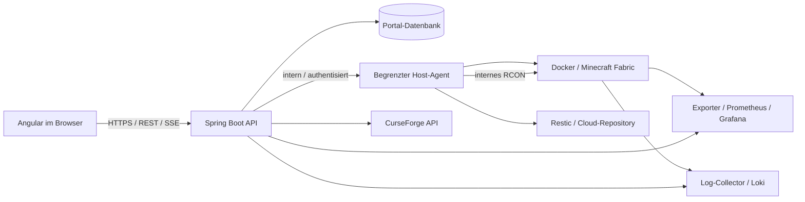

# Architektur und Entscheidungen

## Zielbild

Proxmox bleibt die bestehende Virtualisierung. Der genaue Ort des Docker-Hosts wird bei der Bestandsaufnahme geklärt. Ein Proxmox-Administratorzugang ist für normale Serveraktionen nicht erforderlich. Angular kennt weder RCON-Passwort noch Docker-Socket oder Cloud-Key.

## ADR-001: Fachliche API mit begrenztem Agent

Entscheidungsvorschlag: Spring Boot prüft Identität, Rolle und Serverzugriff. Ein Agent auf dem Docker-Host akzeptiert ausschließlich feste Operationsarten für einen konfigurierten Container und feste Datenpfade. Keine beliebigen Container-IDs, Mounts, Docker-Optionen, Befehlszeilen oder Hostpfade aus dem Browser. Der Agent erhält nur intern erreichbare, authentisierte Verbindungen und eigene, eng begrenzte Dateirechte.

Docker-Socket-Zugriff ist weitreichend. Ein einfacher Socket-Proxy begrenzt zwar API-Routen, ersetzt aber keine Container- und Parameterprüfung. Direkter Socket-Mount in das öffentliche Backend ist nicht der gewählte Entwurf. Agent-Privilegien, Netzgrenzen und Sicherungsstrategie müssen vor Deployment geprüft werden.

## ADR-002: Jobs und Zustände

Langlaufende Operationen antworten mit HTTP 202 und Job-ID. Jobs werden dauerhaft gespeichert und pro Server serialisiert. Backup, Restore, Modwechsel und Neustart dürfen nicht gleichzeitig die Welt oder das Modverzeichnis verändern. Idempotency-Key verhindert doppelte Mutationen bei Retries. Nach Backend-Neustart wird der tatsächliche Hostzustand abgeglichen; unbekannte Ergebnisse werden nicht als Erfolg markiert.

Lifecycle: UNKNOWN, OFFLINE, STARTING, RUNNING, STOPPING, ERROR. Davon unabhängig: Aktivität NONE, BACKUP, RESTORE, MOD_CHANGE und Health OK, DEGRADED, FAILED, UNKNOWN. So bleibt „Online · Backup läuft“ möglich. Docker „running“ allein ist kein Beleg für einen spielbereiten Server; Readiness benötigt Minecraft-/RCON-Prüfung. RCON-Ausfall bei laufendem Server ist zunächst DEGRADED.

## ADR-003: Konsole und Logs

Kommandos per REST an das Backend, RCON intern zum Minecraft-Server. Antworten erscheinen mit Command-ID, Absender und Zeitstempel. RCON liefert keine vollständige kontinuierliche Serverlog-Subscription. Dafür dient ein eigener Docker-/Loki-Logstrom. SSE reicht für die unidirektionale Live-Ausgabe im MVP; WebSocket bleibt eine spätere Option. Reconnect mit Cursor, begrenzte Puffer und langsame Clients berücksichtigen.

## ADR-004: Daten und Konfiguration

Vorgeschlagen ist PostgreSQL für Portalnutzer-Zuordnung, Rollen, Jobs, Audit, Backup-Metadaten und den Sollzustand der Mods. Minecraft-Welten bleiben auf dem bestehenden Datenvolume. Secrets liegen in gemounteten Secret-Dateien oder einem Secret Store. server.properties wird über ein typisiertes Schema mit Allowlist editiert; Kommentare und nicht verwaltete Werte bleiben erhalten. Änderungen atomar schreiben, Revision prüfen und erforderlichen Neustart anzeigen. Container-Umgebungsvariablen können Konfiguration beim Start überschreiben: pro Einstellung genau eine Quelle festlegen.

## ADR-005: Observability

Prometheus sammelt Host-/Container-/Backend-Metriken; Grafana stellt historische Ansichten bereit; Loki sammelt Logs über einen gewählten Collector. TPS/MSPT benötigen einen geeigneten Minecraft-Exporter bzw. eine kompatible Mod und sind vor dessen Nachweis „nicht verfügbar“. Server-RAM, JVM-Heap und Containerlimit getrennt benennen. Alerts: nicht erreichbar, Startfehler, Backup älter als 24 Stunden, Festplatte knapp und anhaltende Tick-Probleme. Konkrete Schwellwerte nach Messung festlegen. Keine ungeschützten Grafana-/Loki-Endpunkte im Browser.
