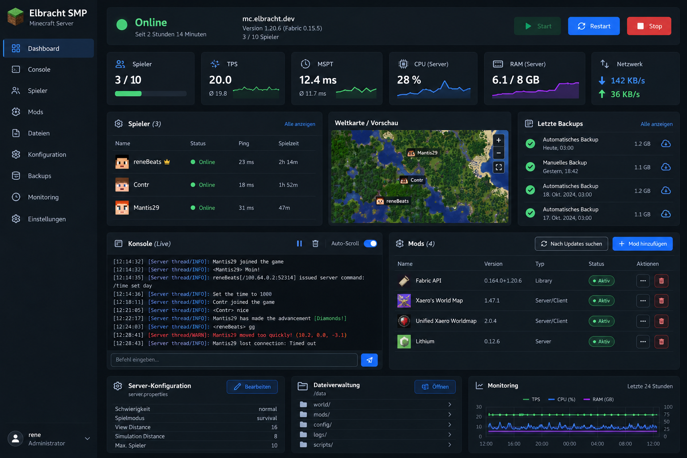

# UI/UX-Referenz

## Verfügbares Originalbild

Gesichert aus dem abrufbaren Homelab-Anhang. Das zweite gewünschte Bild `elbracht_smp_server_dashboard.png` ist noch nicht verfügbar. Es wird nicht durch eine umbenannte Kopie ersetzt.

## Beobachtete Gestaltung

Dunkles Dashboard mit permanenter linker Navigation, blauem Akzent und grünen Statusanzeigen. Oben stehen Serverstatus, Version und Betriebsaktionen. Darunter kompakte Karten für Spieler, TPS, MSPT, CPU, RAM und Netzwerk. Große Bereiche enthalten Spieler, Weltkarte, letzte Backups, Live-Konsole und Modliste. Unten stehen Konfiguration, Datenverzeichnis und historische Metriken.

Die Sidebar führt zu Dashboard, Console, Spieler, Mods, Dateien, Konfiguration, Backups, Monitoring und Einstellungen. Die geplante Anwendung ergänzt eine klar erkennbare Logansicht. Dateiverwaltung bleibt bis zur sicheren Umfangsdefinition nachrangig.

## Übernahme der Nutzerwünsche

- Ein gemeinsames Spielerziel für Sidebar und „Alle anzeigen“. Spieler hinzufügen führt zur Whitelist; OP ist ein eigener Admin-Schalter mit Bestätigung. Erfolg erst nach bestätigter Aktion anzeigen.
- Status in verständlichem Deutsch: „Offline“, „Startet“, „Online“, „Wird beendet“, „Start fehlgeschlagen“. Aktivität ergänzen: „Online · Backup läuft“ oder „Offline · Wiederherstellung läuft“. Bei Messausfall „Status unbekannt“ mit letzter Aktualisierung.
- Moddialog zeigt aktive Minecraft-Version und Fabric als feste Auswahlgrundlage. Suchfeld, reduzierte Trefferkarten, konkrete passende Datei, Abhängigkeiten und Installationsplan. Bei fehlendem Match klare Leermeldung.
- Konsole zeigt Quelle: „Minecraft-Antwort“ gegenüber „Serverlog“. Auto-Scroll pausierbar, Filter, Rückstaugrenze und Wiederverbindungsanzeige. Kommandoeingabe nach Rolle.
- Backupkarte zeigt letzte erfolgreiche Cloud-Sicherung und laufende/fehlgeschlagene Jobs. Restore auf eigener Seite mit Ziel, Snapshotzeit und Auswirkungen.

## Grenzen des Mockups

Alle Werte und Identitäten im Bild sind illustrative Referenzinhalte. Minecraft 1.20.6 im Bild ist keine Korrektur von 26.3 aus dem Auftrag. Ping, Spielzeit, TPS/MSPT und Live-Karte werden erst bei verfügbarer Datenquelle eingeblendet. Keine ausgedachten Kurven oder zufälligen Werte im produktiven Dashboard.

## Zugänglichkeit und Zustände

Status zusätzlich als Text/Icon, nicht nur Farbe; Tastaturbedienung, sichtbarer Fokus, ausreichend große Aktionen und Kontrast prüfen. Destruktive Aktionen räumlich von normalen Funktionen trennen. Mobile Ansicht stapelt Karten und priorisiert Status, Jobs und Spieler; breite Konsole/Tabellen kontrolliert scrollbar. Lade-, Leer-, Fehler-, Offline- und fehlende Berechtigungszustände für jede Seite vorsehen.
